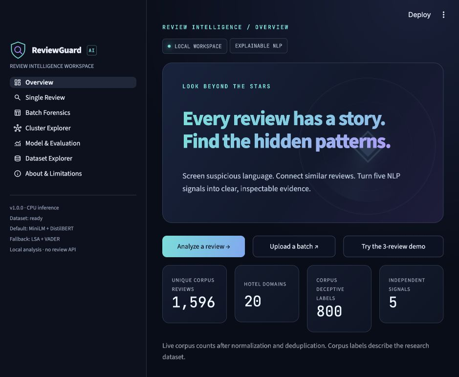

# ReviewGuard AI

**Explainable detection of suspicious and coordinated online reviews using NLP.**

A complete local Streamlit workspace with a separate Python backend, CPU inference, trained and calibrated classifiers, actual evaluation, reproducible scripts, and tests. Suspicion scores support human review; they do not prove deception.



## Start the delivered project

Use **Python 3.11**. Final verification used Python 3.11.17 on macOS ARM64. A terminal with `make` is assumed; Windows users can use the direct Python equivalents below.

```bash
git clone https://github.com/amaan240821/reviewguard-ai.git
cd reviewguard-ai
python3.11 -m venv .venv
source .venv/bin/activate
python -m pip install -r requirements.txt
make app
```

Open **http://localhost:8501**. On Windows, activate with `.venv\Scripts\activate` and run `python -m streamlit run app/Home.py`.

The package already includes the real corpus, trained classifier, split files, demo CSVs, evaluation metrics and figures. You do not need to retrain to use it. Public pretrained weights download from Hugging Face on first analysis and cache under `models/hf_cache/`. The compact ZIP excludes those large caches; the local project folder retains them. If downloads are unavailable, VADER and TF-IDF/LSA work as explicit fallbacks. Under Advanced settings, select the lightweight offline option to avoid downloads entirely.

## Reproduce data, training, evaluation, and tests

```bash
make data
make train
make evaluate
make test
```

Equivalent commands:

```bash
python scripts/download_data.py
python scripts/build_demo_data.py
python scripts/train.py
python scripts/evaluate.py
python -m pytest
```

`make data` keeps an existing corpus. To use another copy, place a CSV with `deceptive,hotel,polarity,source,text` at `data/raw/deceptive-opinion.csv`. The downloader tries authenticated Kaggle when configured, then the original author's public archive, and gives manual instructions if both fail. The raw download contains 1,600 rows; deduplication leaves 1,596 unique reviews. The corpus contains no star ratings.

Models compare five-fold training CV F1 before selection. TF-IDF + Linear SVM won the delivered run. Sigmoid calibration happens inside training folds. A label × polarity stratified split reserves 320 reviews for final evaluation. Thresholds are selected from training OOF predictions, then frozen. Hotel-held-out evaluation uses five GroupKFold folds on the separate training pool.

## Actual measured results

### Heldout classifier

| Metric | Value |
|---|---:|
| accuracy | 0.9125 |
| precision | 0.8976 |
| recall | 0.9313 |
| f1 | 0.9141 |
| roc_auc | 0.9640 |
| pr_auc | 0.9628 |

### Heldout design-weight composite

| Metric | Value |
|---|---:|
| accuracy | 0.8781 |
| precision | 0.8623 |
| recall | 0.9000 |
| f1 | 0.8807 |
| roc_auc | 0.9418 |
| pr_auc | 0.9330 |

### Hotel-held-out classifier, training pool only

| Metric | Value |
|---|---:|
| accuracy | 0.8746 |
| precision | 0.8659 |
| recall | 0.8875 |
| f1 | 0.8765 |
| roc_auc | 0.9434 |
| pr_auc | 0.9469 |

The classifier threshold is 0.42; the composite threshold is 0.33. These thresholds are distinct from the four operational UI bands. The composite measures additional review phenomena and is not expected to outperform the supervised classifier on this corpus's binary labels.

Synthetic-group recovery: **23/23 within-group pairs recovered (100%)**. This is demonstration validation, not real-world coordination accuracy.

## Seven connected pages

- **Overview:** live corpus counts, workflow, and one-click three-review coordination demonstration.
- **Single Review:** six examples, optional stars, training/session reference pool, live configurable weights, gauge, contribution waterfall, highlighted wording, counter-evidence, similar-review diffs, linear model terms, JSON and PDF.
- **Batch Forensics:** CSV upload, text/rating/metadata mapping, validation, progress, KPIs, distribution and signal charts, searchable/sortable/filterable evidence, synthetic-row flags, clusters, annotated CSV, pair CSV and PDF.
- **Cluster Explorer:** interactive graph, adjustable threshold, cluster selector, hover text, review details, and an 800-node display cap.
- **Model & Evaluation:** real metrics, confusion matrix, ROC/PR curves, four-model comparison, ablations, design vs learned coefficients, synthetic recovery and artifact downloads.
- **Dataset Explorer:** class/polarity/hotel/length distributions, top terms, search and hotel filters.
- **About & Limitations:** scoring formula, signal definitions, design choices, ethical use and future scope.

## Scoring

D = duplication (30%), C = calibrated deception classifier (25%), L = language anomaly (20%), R = rating mismatch (15%), E = extreme sentiment (10%). Every available signal is in [0,1]; missing signals are omitted and weights are renormalized. Weights are configurable design choices, not scientific constants. Continuous bands: <=30 Low, >30–60 Moderate, >60–80 High, >80–100 Very High.

Similarity edges use max(MiniLM cosine, character-5-gram cosine). Both values are inspectable. Connected components are transitive groups: two reviews may be linked through an intermediate review without themselves crossing the threshold.

## Python API and CLI

```python
from reviewguard.pipeline import analyze_review, analyze_batch
import pandas as pd

single = analyze_review("The room was clean, but the elevator was slow.", rating=4)
print(single.to_dict())
batch = analyze_batch(pd.read_csv("data/samples/demo_batch.csv"),
                      {"text": "text", "rating": "rating"})
print(batch.reviews[["suspicion_score", "risk_band", "cluster_id"]])
```

```bash
python scripts/cli.py --text "The room was clean." --rating 4 --output analysis.json
python scripts/cli.py --csv data/samples/demo_batch.csv --rating-column rating --output batch.csv
python scripts/cli.py --csv data/samples/demo_batch.csv --rating-column rating --output batch.pdf
```

Use `--offline` for VADER/LSA. Backend code has no Streamlit dependency at import boundaries except the frontend package itself; the installed requirements include UI dependencies for the complete application.

## Files and reports

```text
app/                  Streamlit entry, six pages, shared UI, CSS and Plotly
reviewguard/          Modular preprocessing, models, similarity, scoring, explanations, reports
scripts/              Data acquisition, demo building, training, evaluation, CLI
models/               Trained classifier, model card, OOF predictions; local caches
 data/                Raw, processed and sample reviews; phrase lexicon
reports/metrics.json  Actual evaluation results
reports/tables/       CV comparison, holdout predictions, ablations, hotel folds
reports/figures/      Ten labelled 300-DPI figures
 tests/               Backend, behavioural, integration, report and Streamlit tests
 docs/                Architecture, decisions, model card, captions, verification, screenshots
```

See [figure captions](docs/REPORT_ASSETS.md), [architecture](docs/ARCHITECTURE.md), [model card](docs/MODEL_CARD.md), [decisions](docs/DECISIONS.md), and [verification](docs/VERIFICATION.md).

## Troubleshooting and limitations

- **No dataset:** `make data`, or place the Kaggle CSV at the documented path. The app shows a missing-data state.
- **No classifier:** `make train`. Other available signals continue to work with renormalized weights.
- **Model downloads fail:** choose lightweight offline models. Fallback status appears in the result; fallback similarities differ from MiniLM.
- **First run is slow:** model imports/downloads and initial corpus encoding need time. Subsequent sentiment/embedding and UI results are cached. `HF_HUB_OFFLINE=1` uses already-downloaded assets without network checks.
- **CSV errors:** use UTF-8, include nonempty review text, keep optional ratings numeric in [1,5], and limit files to 10 MB / 5,000 rows. Graphs show at most 800 nodes; the table and statistics retain the full batch.
- **Port in use:** `python -m streamlit run app/Home.py --server.port 8502`.
- **Hardware:** CPU-only models; tested locally on macOS ARM64. The 8 GB / low-end laptop target was not separately benchmarked. Dense matrices at the 5,000-row cap can consume several hundred MB; smaller batches are faster.
- **Model artifacts:** load only trusted joblib files. This application ships its own trained artifact; it does not accept uploaded models.
- **Scope:** English hotel reviews only. The corpus is crowd-written research data, not a naturally occurring fraud dataset. Promotional wording and similar opinions are often legitimate. Sentiment may miss sarcasm. Synthetic clusters do not validate natural coordination detection. Fine-tuning is an optional prompt extension and is not implemented.

## Dataset attribution

Original source: [Ott Deceptive Opinion Spam Corpus](https://myleott.com/op-spam.html), [v1.4 archive](https://myleott.com/op_spam_v1.4.zip). The original licence is included as `data/raw/CORPUS_LICENSE.txt`. Cite Ott et al. (2011), *Finding Deceptive Opinion Spam by Any Stretch of the Imagination*, and Ott et al. (2013), *Negative Deceptive Opinion Spam*. Synthetic demo rows are explicitly marked `demo_injected=True` and are never used to train or evaluate the corpus classifier.
