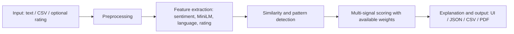

# Architecture

The `reviewguard/` package contains no Streamlit imports. `pipeline.analyze_review()` returns a `ReviewResult`; `pipeline.analyze_batch()` returns a `BatchResult`. Both expose JSON-safe `to_dict()` methods. Streamlit pages call only backend APIs and presentation helpers.

Raw text is retained for punctuation/capitalization features; cleaned text is used for model inference. MiniLM is a fixed pretrained encoder. Fallback LSA is fit within classifier training folds and within evaluation reference pools. In an exploratory batch, LSA is intentionally fit on that uploaded batch, without supervised labels. Cached embeddings and sentiment outputs are keyed by text hashes and backend.

The dense similarity matrices use float32 and chunked cosine computation. The 5,000-row cap controls memory; lexical matrices are also chunked. Network display is capped at 800 nodes. Connected components are transitive groups, not proof of coordination. Each result includes source text, normalized signals, contribution points, highlighted spans, neighbours, warnings, and counter-evidence.

Training stores a calibrated classifier, OOF predictions, deterministic split CSVs, and a model card. Evaluation selects thresholds and learns alternative signal weights on training OOF predictions only. Five hotel-held-out folds run only on the training pool; the final 20% test remains untouched until final evaluation.
